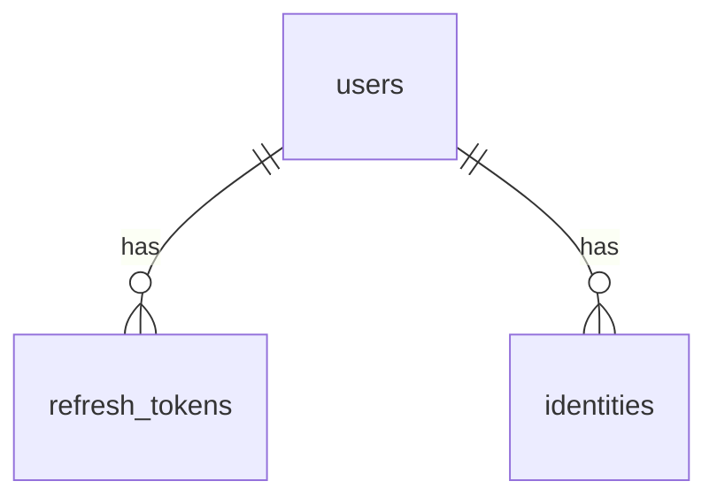
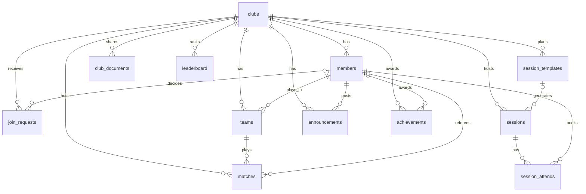
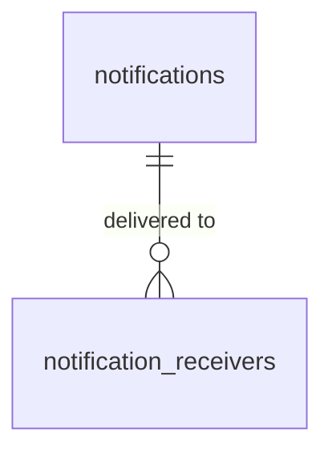

# Database

UM6P Rackets uses one PostgreSQL database (`rackets_db`) with **one schema per service**. Each service accesses it through Prisma, with its own database role. For how the services fit together, see [ARCHITECTURE.md](ARCHITECTURE.md).

| Schema | Service | Role | Tables |
|---|---|---|---|
| `auth_schema` | auth-service | `auth_service` | `users`, `refresh_tokens`, `identities` |
| `club_schema` | club-service | `club_service` | `clubs`, `members`, `join_requests`, `session_templates`, `sessions`, `session_attends`, `teams`, `matches`, `announcements`, `club_documents`, `achievements`, `leaderboard` |
| `notification_schema` | notification-service | `notification_service` | `notifications`, `notification_receivers` |

## Rules for the whole database

- **Isolation.** A service can only use its own schema, and never reads another service's tables.
- **No foreign keys between schemas.** A `user_id` that points to a user is a plain integer. When the club service needs user data (name, avatar), it asks the auth service and merges the result. In the Prisma files these columns are marked "auth service user id, no relation".
- **Ids.** Auto-increment integers, except `notifications` and `notification_receivers` (`BigInt`) and `identities` (UUID).
- **Dates.** Stored as `timestamptz`, in UTC. The one time zone used for day and week calculations is applied by the application, not by the database. Two columns are plain timestamps: `users.reset_token_expiry` and `leaderboard.updated_at`.
- **Statuses and roles** that belong to the club service are small integers. Their meaning is defined in the service code and listed in the tables below.
- **Soft delete.** `users.deleted_at` and `clubs.deleted_at` mark a row as deleted without removing it. A member who leaves a club keeps the row (`members.left_at`), and sessions and matches are cancelled with a date (`cancelled_at`), never deleted.
- **Migrations and seeds.** Each service has its own committed Prisma migrations and a seed. The `*-migrate` and `*-seed` containers run them once at startup.

## 1. auth_schema

### users
| Column | Type | Notes |
|---|---|---|
| `id` | int, PK | |
| `login` | varchar(255) | unique |
| `first_name`, `last_name` | varchar(255) | |
| `email` | varchar(255) | unique |
| `gender` | boolean, null | |
| `department` | text, null | |
| `phone_number` | varchar(50), null | |
| `avatar` | text, null | |
| `password_hash` | text, null | argon2 hash. Null for accounts created only with Google |
| `role` | enum `UserRole` | `USER` (default) or `ADMIN`. This is the platform role. Roles inside a club are in `members.role` |
| `joined_at` | timestamptz | default now |
| `deleted_at` | timestamptz, null | soft delete |
| `reset_token_hash` | text, null | hash of the password reset token |
| `reset_token_expiry` | timestamp, null | |

### refresh_tokens
| Column | Type | Notes |
|---|---|---|
| `id` | int, PK | |
| `token_hash` | varchar(64) | unique. SHA-256 hash, the token itself is never stored |
| `family_id` | uuid | groups the tokens of one login chain, so the whole chain can be revoked if a used token comes back |
| `is_revoked` | boolean | default false |
| `expires_at`, `created_at` | timestamptz | |
| `user_id` | int, FK to `users` | on delete: cascade |

### identities
Links a user to an external login provider (Google).

| Column | Type | Notes |
|---|---|---|
| `id` | uuid, PK | |
| `provider` | text | for example `google` |
| `subject` | text | the user id at the provider |
| `user_id` | int, FK to `users` | on delete: cascade, indexed |
| `created_at` | timestamptz | |

Unique: (`provider`, `subject`).

## 2. club_schema

### clubs
| Column | Type | Notes |
|---|---|---|
| `id` | int, PK | |
| `name` | varchar(255) | unique |
| `slug` | varchar(255) | unique, used in URLs |
| `description`, `avatar` | text, null | |
| `created_at` | timestamptz | |
| `deleted_at` | timestamptz, null | soft delete |

### members
A user inside a club.

| Column | Type | Notes |
|---|---|---|
| `id` | int, PK | |
| `club_id` | int, FK to `clubs` | on delete: cascade |
| `user_id` | int | auth user id, no relation, indexed |
| `role` | int | 0 member, 1 leader, 2 coach |
| `joined_at` | timestamptz | |
| `left_at` | timestamptz, null | null means active member |

Unique: (`club_id`, `user_id`). A user who leaves and comes back reuses the same row.

### join_requests
| Column | Type | Notes |
|---|---|---|
| `id` | int, PK | |
| `club_id` | int, FK to `clubs` | on delete: cascade |
| `user_id` | int | auth user id, no relation |
| `status` | smallint | 0 pending, 1 accepted, 2 rejected, 3 cancelled |
| `requested_at` | timestamptz | reset to now every time the user asks again |
| `decided_at` | timestamptz, null | set when a leader accepts or rejects |
| `decided_by` | int, null, FK to `members` | the leader. Null while pending, or when the user cancelled. On delete: set null |

Unique: (`club_id`, `user_id`). The same row is reopened when the user asks again. Index: (`club_id`, `status`, `requested_at`).

### session_templates
The weekly plan of a club.

| Column | Type | Notes |
|---|---|---|
| `id` | int, PK | |
| `club_id` | int, FK to `clubs` | on delete: cascade |
| `weekday` | smallint | 0 Monday to 6 Sunday |
| `start_time` | varchar(5) | `HH:mm` |
| `duration_minutes` | int | 1 to 1440, can cross midnight |
| `title`, `location` | varchar(100), null | |
| `capacity` | int | number of spots |
| `created_at`, `updated_at` | timestamptz | |

### sessions
A real session on a real date, created from a template.

| Column | Type | Notes |
|---|---|---|
| `id` | int, PK | |
| `club_id` | int, FK to `clubs` | on delete: cascade |
| `template_id` | int, null, FK to `session_templates` | null means the session was detached from its plan. On delete: set null |
| `start_at`, `end_at` | timestamptz | |
| `title`, `location` | varchar(100), null | |
| `capacity` | int | copied from the template, can be changed per session |
| `cancelled_at` | timestamptz, null | null means active. A cancelled session is kept |
| `created_at`, `updated_at` | timestamptz | |

Unique: (`template_id`, `start_at`), so a plan can never create the same session twice. Index: (`club_id`, `start_at`).

### session_attends
A booking.

| Column | Type | Notes |
|---|---|---|
| `id` | int, PK | |
| `session_id` | int, FK to `sessions` | on delete: cascade |
| `member_id` | int, FK to `members` | on delete: cascade, indexed |
| `created_at` | timestamptz | |

Unique: (`session_id`, `member_id`), so a member books a session only once.

The reasoning behind `session_templates`, `sessions` and `session_attends` is in [SESSIONS.md](SESSIONS.md).

### teams
One player for singles, two for doubles.

| Column | Type | Notes |
|---|---|---|
| `id` | int, PK | |
| `club_id` | int, FK to `clubs` | on delete: cascade |
| `player1_id` | int, FK to `members` | |
| `player2_id` | int, null, FK to `members` | null means singles |
| `created_at` | timestamptz | |

### matches
| Column | Type | Notes |
|---|---|---|
| `id` | int, PK | |
| `club_id` | int, FK to `clubs` | on delete: cascade |
| `team1_id`, `team2_id` | int, FK to `teams` | |
| `winner_id` | int, null, FK to `teams` | only set when the status is 2 |
| `ref_id` | int, null, FK to `members` | the referee, set when a leader accepts |
| `team1_score`, `team2_score` | int | default 0 |
| `team1_points`, `team2_points` | int | ladder points, default 0 |
| `mode` | int | 1 singles, 2 doubles |
| `status` | smallint | 0 pending, 1 confirmed, 2 finished, 3 cancelled |
| `location` | varchar(100), null | |
| `scheduled_at` | timestamptz | |
| `cancelled_at` | timestamptz, null | |
| `cancelled_by` | int, null, FK to `members` | null means cancelled by the system. On delete: set null |
| `created_at` | timestamptz | |

Index: (`club_id`, `status`, `scheduled_at`).

### announcements
| Column | Type | Notes |
|---|---|---|
| `id` | int, PK | |
| `club_id` | int, FK to `clubs` | on delete: cascade |
| `announcer_id` | int, FK to `members` | the author |
| `description` | text | |
| `created_at` | timestamptz | |

Index: (`club_id`, `created_at` descending), for the newest-first feed.

### club_documents
| Column | Type | Notes |
|---|---|---|
| `id` | int, PK | |
| `club_id` | int, FK to `clubs` | on delete: cascade |
| `title` | varchar(255) | |
| `description` | text, null | |
| `path` | text | the link of the document |

### achievements
| Column | Type | Notes |
|---|---|---|
| `id` | int, PK | |
| `club_id` | int, FK to `clubs` | on delete: cascade |
| `user_id` | int | auth user id, no relation, indexed |
| `code` | varchar(50) | the achievement code. The service validates it against the list of 14 codes |
| `awarded_by` | int, null, FK to `members` | null means awarded automatically. On delete: set null |
| `taken_at` | timestamptz | |

Unique: (`club_id`, `user_id`, `code`), so an achievement is given once per club. Index: (`club_id`, `taken_at` descending).

### leaderboard
One row of statistics per member of a club.

| Column | Type | Notes |
|---|---|---|
| `id` | int, PK | |
| `club_id` | int, FK to `clubs` | on delete: cascade |
| `user_id` | int | auth user id, no relation |
| `member_id` | int | unique, plain id (no relation) |
| `points`, `wins`, `losses`, `total_matches` | int | default 0 |
| `win_streak`, `best_win_streak` | int | default 0 |
| `updated_at` | timestamp | |

Unique: (`club_id`, `user_id`, `member_id`). The main index follows the ranking order: points (high first), then wins (high first), then losses (low first), then total matches (high first), then `member_id`. This makes the leaderboard a simple indexed read.

## 3. notification_schema

A notification is stored once, and one row per user records who received it and whether they read it.

### notifications
| Column | Type | Notes |
|---|---|---|
| `id` | bigint, PK | |
| `event_id` | text | unique. Identifies the source event, so the same event can never create the notification twice |
| `sender_type` | enum `SenderType` | `SYSTEM` or `USER` |
| `sender_id` | bigint, null | |
| `sender_name`, `sender_avatar_url` | text, null | a copy taken when the notification was created |
| `category` | enum `NotificationCategory` | `CLUB` or `USER` |
| `type` | enum `NotificationType` | `JOIN_REQUESTED`, `JOIN_ACCEPTED`, `JOIN_REJECTED`, `CLUB_ANNOUNCEMENT` |
| `club_id` | bigint, null | |
| `club_name` | text, null | a copy taken when the notification was created |
| `sent_at` | timestamptz | |

The sender and club names are stored as a copy so the inbox can be shown without calling the other services, and without changing when a name changes later. Indexes: (`category`, `id` descending) and (`club_id`, `id` descending).

### notification_receivers
| Column | Type | Notes |
|---|---|---|
| `id` | bigint, PK | |
| `notification_id` | bigint, FK to `notifications` | on delete: cascade |
| `receiver_user_id` | bigint | auth user id, no relation |
| `is_read` | boolean | default false |
| `read_at` | timestamptz, null | |

Unique: (`notification_id`, `receiver_user_id`). Indexes: (`receiver_user_id`, `id` descending) for the inbox, and (`receiver_user_id`, `is_read`) for the unread counter.