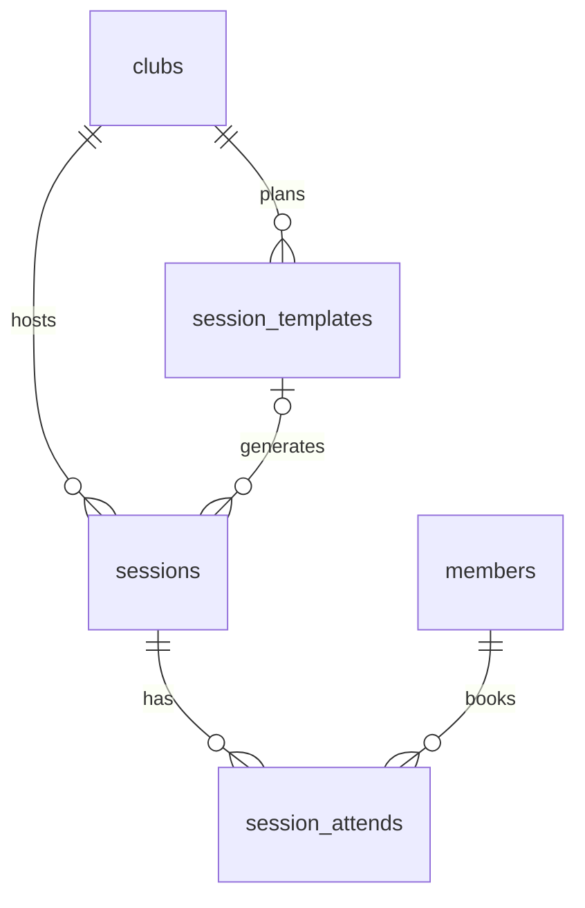

# Club sessions and booking

This is the custom Major module of the project. It lets a club publish its weekly training schedule, lets members book a spot, and lets leaders manage the schedule. For the endpoints see [API.md](API.md), and for the tables see [DATABASE.md](DATABASE.md).

## 1. Why this module

Racket clubs train every week, at fixed times, with a limited number of spots. Members need to see a week and book a spot. Leaders need to set the schedule once, and still be able to change or cancel a single day. A simple list of events does not solve this, because:
- the weekly plan repeats, but each real session has its own bookings, and a change in the plan must never rewrite the past;
- the number of spots is limited, so two people who book the last spot at the same time must not both succeed;
- weeks, "today" and midnight depend on a time zone;
- a leader needs to choose whether an edit is for one day or for all the future days.

## 2. Data model

```
session_templates   the weekly plan: weekday, start time, duration, title, location, capacity
sessions            one real session per date, with its own start_at, end_at, title, location, capacity
session_attends     a booking: one member in one session
```



- **Template.** A plan line such as "Monday 18:00, 90 minutes, 12 spots". The weekday is 0 (Monday) to 6 (Sunday), the start time is text in `HH:mm`, and the duration is 1 to 1440 minutes, so a session can cross midnight.
- **Session.** A real date, stored with `start_at` and `end_at` (`timestamptz`) and its own copy of the title, location and capacity. Because the session keeps its own copy, changing the plan later does not change a session that already exists.
- **Booking.** One row per member and session. The pair is unique, so nobody books twice.
- `sessions.template_id` is null when a session is detached from a plan (a one-time session, or a session whose plan was deleted). It is set to null automatically if the template is deleted.
- A session is **never deleted**. Cancelling sets `cancelled_at`, and the row stays, so the history is kept and the plan never recreates it.

## 3. Time

- All the day and week calculations use one time zone, `Africa/Casablanca` (UTC+0 since 20 September 2026), and never the time of the server. The offset is defined in one constant in `libs/common/src/dates.ts`.
- Weeks run from Monday to Sunday. A session belongs to the week in which it **starts**, even if it ends after midnight.
- A session whose `end_time` is earlier than its `start_time` ends the next day (for example 23:00 to 01:00). Equal times are rejected.
- Stored dates are absolute instants, so a session that already exists does not move if the offset changes later. Only the sessions generated after the change use the new offset.

## 4. The week view

`GET /clubs/:slug/sessions?week=YYYY-MM-DD` returns the sessions that start in that week, sorted by `start_at`, cancelled ones included.

| Rule | Value |
|---|---|
| Default week | the current week |
| `week` parameter | any date of the week, the server uses its Monday |
| Past weeks | read-only history, up to one year back |
| Future weeks | only one week ahead |
| Anything else | 400 |

Each session in the answer has a `state`. The states used by the interface are `open`, `ongoing`, `ended` and `cancelled`, and each session also carries `spots_left` and `is_joined` for the current user. The Join button is shown only when `spots_left > 0`, `is_joined` is false and `state` is `open` or `ongoing`.

## 5. Generating the sessions from the plan

The sessions of a week are created from the plans **on demand**, when someone opens the week view, and not by a scheduled job.

- Only **next week** is generated. The current week is never generated from the plans, and past weeks are never generated. If nobody opens the app during a whole week, the following week stays empty, and a leader adds its sessions by hand.
- One session is created per plan and date. The pair (`template_id`, `start_at`) is unique, so the same session can never exist twice, even if two users open the same week at the same moment: the second insert is ignored by the database.
- A session that has already ended is not created.
- Several sessions at the same time are allowed.
- A cancelled session is kept, so the generation does not bring it back.

Because generation happens inside a `GET`, opening next week can write rows. This is on purpose: it needs no scheduler and a new plan appears the first time someone looks.

## 6. Leader actions

### Create a session
`POST /clubs/:slug/sessions` with `weekday`, `start_time`, `end_time`, `capacity` (1 to 1000), optional `title` and `location` (up to 100 characters), `week_start` (default: the current week) and `repeat_weekly`.
- With `repeat_weekly: false` (default) only that week gets the session.
- With `repeat_weekly: true` a weekly plan is also saved, so the next weeks get the session too.
- A session that has already ended is not created.
- If a cancelled session exists at the same start, it is **reused**: `cancelled_at` is cleared, its fields are updated and its old bookings are removed. This avoids a second row for the same slot.
- If the exact same slot already exists and is active: 409. The database unique constraint does not cover sessions without a plan (in PostgreSQL, null values are all different), so this check is done by the service.

### Edit a session
`PATCH /clubs/:slug/sessions/:sessionId`, with a choice of scope:

| `apply_to_future` | What changes |
|---|---|
| `false` (default) | this session only |
| `true` | this session, all the later sessions that have not ended, and the weekly plan |

- `start_time` and `end_time` are sent together.
- The weekday cannot change. To move a slot to another day, delete it and create a new one.
- 422 if the session is already ended or cancelled, or if the new `capacity` is lower than the bookings of any session that would be changed.
- Members who booked are notified when the time or the location changes.

### Cancel a session
`DELETE /clubs/:slug/sessions/:sessionId`

| `apply_to_future` | What happens |
|---|---|
| `false` (default) | this session is cancelled (`cancelled_at`) |
| `true` | the weekly plan is deleted, and the later sessions that have not ended are cancelled |

- No session row is ever deleted. The sessions of a deleted plan lose their `template_id` and stay as history.
- A session that has ended cannot be cancelled.
- Members who booked are notified.

## 7. Booking

| Action | Endpoint | Rule |
|---|---|---|
| Book | `POST /clubs/:slug/sessions/:sessionId/attend` | Allowed while spots are left and the session is not cancelled and not ended. It is also allowed while the session is ongoing. |
| Cancel the booking | `DELETE /clubs/:slug/sessions/:sessionId/attend` | Only before the session starts. |
| My bookings | `GET /clubs/:slug/members/me/attendance` | Newest first. |

Errors when booking: 404 if the session is not in this club, 422 if it is cancelled or ended, 409 if it is full or already booked by this member.

**Booking under concurrency.** Booking runs in one transaction. The session row is locked first (`SELECT ... FOR UPDATE`), then the number of bookings is counted and compared with `capacity`, and the booking is saved only if a spot is left. Two members who click on the last spot at the same time are handled one after the other: the first gets the spot, and the second gets 409.

If a member leaves the club, their bookings on the sessions that have not ended are removed.

## 8. Notifications

After the database save, the club service sends a notification to the booked members when a session is cancelled, or when its time or its location changes. No notification is sent for the bookings themselves. See [API.md](API.md) for the notification rules.

## 9. Edge cases

| Case | Behavior |
|---|---|
| Session crosses midnight (23:00 to 01:00) | belongs to the week in which it starts |
| Two users open next week at the same time | the plan creates each session once (unique constraint) |
| Last spot taken by two users at once | one succeeds, the other gets 409 (row lock) |
| Leader lowers the capacity below the bookings | 422, nothing changes |
| Leader cancels, then creates the same slot again | the cancelled row is reused, its old bookings are removed |
| Plan deleted | later sessions are cancelled, the older ones stay as history without a plan |
| Past week | read-only, nothing can be edited, booked or cancelled |
| Session ended | cannot be edited, cancelled or booked |

## 10. Why this is a Major module

The scheduling logic is far beyond a simple CRUD:
- a weekly plan separated from the real sessions, so history never changes;
- lazy and safe generation of the next week;
- booking with concurrency control, using a transaction and a row lock;
- one consistent time zone, including sessions that cross midnight;
- edit and cancel with two scopes (one session or all the future), with notifications to the people affected;
- a week-based interface with week navigation and a clear state for every session.

It is the main weekly use of the platform.